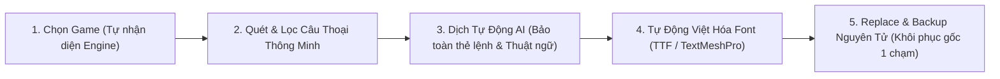

# Translator — Nền Tảng Việt Hóa & Dịch Game Tự Động Đa Engine

**Translator** là công cụ mã nguồn mở hỗ trợ tìm kiếm, bóc tách, dịch thuật và đóng gói ngôn ngữ cho trò chơi điện tử, được xây dựng trên nền tảng **.NET 9** và **Avalonia UI**.

Khởi đầu với bộ nhân xử lý chuyên sâu cho **Unity (cả Mono và IL2CPP)**, dự án được thiết kế theo kiến trúc **Plugin / Adapter** hướng tới mục tiêu dài hạn: trở thành một **Ứng dụng Dịch Game Tự Động Đa Engine (All-in-One Automated Multi-Engine Game Localization Studio)** — nơi người dùng từ cộng đồng dịch thuật chuyên nghiệp đến game thủ phổ thông đều có thể tự động hóa toàn bộ quy trình Việt hóa game chỉ trong một công cụ duy nhất.

---

## Tầm Nhìn Dài Hạn: Quy Trình Việt Hóa Tự Động Khép Kín



---

## Tính Năng Hiện Tại (Giai Đoạn 1 — Unity Scanner & Extractor)

Phiên bản hiện tại đã hoàn thiện luồng **Dò tìm → Lọc thông minh → Tìm kiếm toàn văn → Xem trước → Bóc tách & Xuất bản dịch chuẩn**:

- **Tự động nhận diện Game Unity:** Phát hiện phiên bản Unity Engine và kiến trúc biên dịch (**Mono** hoặc **IL2CPP**).
- **Quét toàn diện 4 tầng lưu trữ văn bản trong Unity:**
  1. **Loose Files:** Các file ngôn ngữ lộ thiên trong `StreamingAssets` (`.json`, `.csv`, `.tsv`, `.xml`, `.txt`, `.ini`, `.yaml`...).
  2. **`TextAsset` (ClassID `49`):** Nằm sâu trong `resources.assets`, `sharedassets*.assets`, `level*` và các gói `AssetBundle` / `Addressables` (giải nén `LZ4`/`LZMA` an toàn qua Stream không gây tràn RAM).
  3. **`MonoBehaviour` (ClassID `114` / `ScriptableObject`):** Hỗ trợ các plugin đa ngôn ngữ phổ biến như *I2 Localization*, *Unity Localization Tables* và hội thoại tự định nghĩa. Tự động khôi phục sơ đồ biến bị ẩn (Stripped TypeTree) qua `Mono.Cecil` (cho Mono), `Cpp2IL` có lưu **Disk Cache** (cho IL2CPP), kèm bộ quét chuỗi nhị phân căn chỉnh 4-byte dự phòng. Tự động gom nhóm các object cùng Class để không sinh ra hàng nghìn file nhỏ lẻ.
  4. **Chuỗi cứng trong Code (Hardcoded Strings):** Quét lệnh IL `ldstr` (bao gồm cả bên trong Coroutine / Async State Machine) của `Assembly-CSharp.dll` và đọc trực tiếp bảng `StringLiteral` trong `global-metadata.dat`.
- **Phát hiện Bundle giấu đuôi & Cảnh báo mã hóa:** Đọc chữ ký byte đầu file (**Magic Bytes**: `UnityFS`, `0xFAB11BAF`, Serialized Header) để bắt trọn các gói dữ liệu bị đổi đuôi sang `.dat`, `.bin` hoặc không có đuôi; tự động gom riêng danh sách cảnh báo nếu phát hiện file bị nhà phát triển mã hóa chống mod.
- **Quét 2 Pha & Tìm kiếm xuyên nội dung (Full-Text Search):**
  - *Pha 1:* Liệt kê nhanh toàn bộ mục chứa text chỉ sau vài giây để duyệt và xem trước ngay.
  - *Pha 2 (Chạy ngầm):* Đánh chỉ mục toàn bộ câu chữ trong game — cho phép bạn gõ bất kỳ câu thoại nào nhìn thấy trên màn hình game (ví dụ `"Press Any Key"`) để truy ra chính xác file hoặc DLL đang giấu câu đó.
- **Lọc rác kỹ thuật thông minh (`TextHeuristicScorer`):** Mặc định ẩn các chuỗi code hệ thống, đường dẫn `Assets/...`, biến shader, mã GUID và dữ liệu nhị phân, đồng thời có công tắc **"Hiện tất cả"** để kiểm tra thủ công khi cần.
- **Bóc tách sâu cấu trúc lồng & Sẵn sàng 100% cho bước Replace:**
  - Tự động phân tích cấu trúc **JSON**, **CSV/TSV**, **XML**, **INI/Key-Value** và **Plain Text** bên trong `TextAsset`/`LooseFile` thành từng câu rời kèm đường dẫn khóa đảo ngược được (`$.ui.menu.start`, `csv:row=1;col=1...`).
  - Xuất đồng thời **Bảng dịch chuẩn `.translator.json`**, **Bảng `.csv` (UTF-8 BOM mở chuẩn dấu tiếng Việt trên Excel)** kèm siêu dữ liệu định vị (`PathID`, `FieldPath`, `LiteralIndex`, `SHA-256`) và tùy chọn xuất **File gốc nguyên bản (`Raw`)**.

---

## Kiến Trúc Mô-đun (Sẵn Sàng Mở Rộng Đa Engine)

Dự án được chia thành các tầng độc lập để phần lõi xử lý dịch thuật và giao diện hoàn toàn tách rời khỏi từng Game Engine:

```text
Translator/
├── Translator.sln
├── README.md                         # Tổng quan dự án & định hướng phát triển
├── RESEARCH_AND_ROADMAP.md           # Nghiên cứu cơ chế lưu trữ text & font trong Unity
├── ARCHITECTURE.md                   # Đặc tả kỹ thuật chi tiết & Hướng dẫn mở rộng từng bước
├── src/
│   ├── Translator.Core/              # Lõi độc lập: Models, Lọc rác, Parsers, Chỉ mục 2 pha, Exporter
│   ├── Translator.Engines.Unity/     # Plugin xử lý Unity (AssetsTools.NET, Mono.Cecil, Cpp2IL)
│   └── Translator.Desktop/           # Giao diện Desktop đa nền tảng (Avalonia UI + Chế độ CLI)
└── tests/
    └── Translator.Tests/             # Bộ kiểm thử tự động (Parsers, Lọc rác, Metadata, .assets)
```

> Xem chi tiết cơ chế nhị phân và hướng dẫn viết thêm plugin cho Engine mới tại [ARCHITECTURE.md](ARCHITECTURE.md).

---

## Hướng Dẫn Cài Đặt & Chạy Dự Án

### Yêu cầu môi trường
- [.NET 9.0 SDK](https://dotnet.microsoft.com/download/dotnet/9.0) trở lên (hỗ trợ Windows, macOS, Linux).

### 1. Build và chạy kiểm thử
```powershell
dotnet build Translator.sln
dotnet test Translator.sln
```

### 2. Khởi chạy Giao diện Desktop (GUI)
```powershell
dotnet run --project src/Translator.Desktop
```

### 3. Sử dụng qua Dòng lệnh (Headless CLI)
Ngoài giao diện đồ họa, bạn có thể tích hợp vào script tự động bằng tham số `--cli-scan`:
```powershell
dotnet run --project src/Translator.Desktop -- --cli-scan "D:\Games\MyUnityGame" --extract "D:\Output\ExtractedText"
```

### 4. Đóng gói ra file `.exe` độc lập (Windows x64)
```powershell
dotnet publish src/Translator.Desktop -c Release -r win-x64 --self-contained true -p:PublishSingleFile=true -o publish/win-x64
```

---

## Lộ Trình Phát Triển Tương Lai: Ứng Dụng Dịch Game Tự Động Đa Engine

Dự án được phát triển theo 5 giai đoạn chiến lược để tiến tới tự động hóa toàn diện việc dịch game:

### Giai đoạn 1: Bộ Máy Dò Tìm & Bóc Tách Chuyên Sâu Cho Unity *(Đã hoàn thành)*
- [x] Quét 4 nguồn Unity (`Loose Files`, `TextAsset`, `MonoBehaviour`, `DLL / global-metadata.dat`).
- [x] Nhận diện Magic Bytes, lọc rác thông minh, quét 2 pha kèm Full-Text Search.
- [x] Xuất bảng dịch chuẩn `.translator.json` / `.csv` lưu sẵn định vị `EntryLocation` và xuất `Raw`.

### Giai đoạn 2: Bộ Đóng Gói Ngược & Kho Sao Lưu Nguyên Tử (Atomic Replacer & Backup Vault)
- [ ] **Kho sao lưu bất biến (`.translator_backup/`):** Tự động sao lưu và đối chiếu mã băm `SHA-256` của file gốc trước khi can thiệp; khôi phục game về nguyên trạng ban đầu chỉ với 1 nút bấm (*Restore Original*).
- [ ] **Atomic Patcher:** Nạp lại file `.translator.json` / `.csv` (hoặc file `Raw`) đã dịch và ghi đè an toàn qua file tạm vào `.assets`, nén lại `AssetBundle` (`LZ4`), cập nhật cây `MonoBehaviour`, vá chỉ thị `ldstr` trong `.dll` và tái cấu trúc bảng offset của `global-metadata.dat`.

### Giai đoạn 3: Tự Động Hóa Việt Hóa Font Chữ (Auto Font Patcher)
- [ ] Tự động quét và kiểm tra các font chữ trong game có hỗ trợ bộ ký tự tiếng Việt Unicode hay không.
- [ ] Cho phép bơm (inject) trực tiếp font `.ttf` / `.otf` tiếng Việt vào đối tượng `Font` của Unity và tự động thay thế / gắn Fallback Atlas cho **`TextMeshPro (TMP_FontAsset)`**, xóa sổ hoàn toàn lỗi hiển thị ô vuông `□□□`.

### Giai đoạn 4: Trung Tâm Dịch Thuật AI Tự Động Thông Minh (AI Localization Studio)
- [ ] **Kết nối đa mô hình AI:** Tích hợp dịch hàng loạt tốc độ cao qua API (Google Gemini, OpenAI, DeepL, Claude) cũng như mô hình AI chạy cục bộ hoàn toàn miễn phí trên máy cá nhân (**Ollama / Local LLM**).
- [ ] **Lá chắn bảo vệ mã lệnh (`Tag & Variable Shield`):** Tự động khóa và bảo toàn 100% các thẻ Rich Text, biến động và ký tự điều khiển của game (`<color=#FF0000>`, `{0}`, `{player_name}`, `%d`, `\n`) không bao giờ bị AI dịch nhầm làm hỏng game.
- [ ] **Từ điển Thuật ngữ (`Glossary`) & Ngữ cảnh nhân vật:** Tự động đồng bộ cách dịch tên riêng, kỹ năng, vật phẩm và đại từ xưng hô xuyên suốt toàn bộ cốt truyện.
- [ ] **Trình biên tập trực tiếp & Bộ nhớ dịch (`In-App Translation Editor & TM`):** Cho phép vừa chạy dịch tự động, vừa chỉnh sửa, đối chiếu câu gốc - câu dịch và kiểm tra độ dài câu ngay trong phần mềm mà không cần mở công cụ ngoài.

### Giai đoạn 5: Mở Rộng Hệ Sinh Thái Đa Game Engine (Multi-Engine Adapters)
Nhờ giao diện chuẩn `IGameEngineAdapter` trong `Translator.Core`, ứng dụng sẽ lần lượt mở rộng các gói plugin hỗ trợ các Engine phổ biến nhất thế giới:
- [ ] **Unreal Engine 4 & 5 (`Translator.Engines.Unreal`):** Đọc/đóng gói `.pak` và `IoStore` (`.utoc`/`.ucas`), dịch trực tiếp bảng ngôn ngữ `.locres` và `DataTable` (`UAsset`), hỗ trợ thay font `.ufont`.
- [ ] **RPG Maker (`Translator.Engines.RpgMaker`):** Hỗ trợ đầy đủ `RPG Maker MV / MZ` (`data/*.json`), `VX Ace` (`.rvdata2`), `VX` và `XP` — tự động bóc mã sự kiện hội thoại (`Code 401`, `102`, `101`) và tự căn dòng tránh tràn khung hội thoại.
- [ ] **Ren'Py (`Translator.Engines.RenPy`):** Giải nén kho lưu trữ `.rpa`, trích xuất kịch bản Visual Novel `.rpy`/`.rpyc` và sinh gói bản dịch `game/tl/vietnamese/` chuẩn chính chủ của Ren'Py.
- [ ] **Godot Engine (`Translator.Engines.Godot`):** Giải nén gói `.pck`, xử lý tài nguyên `.tres`, bảng dịch `.translation` / `.po` và chuỗi giao diện trong GDScript.
- [ ] **Web / HTML5 & Custom VN Engines:** Hỗ trợ các game đóng gói bằng Electron / NW.js, TyranoBuilder và Kirikiri/KAG.

---
