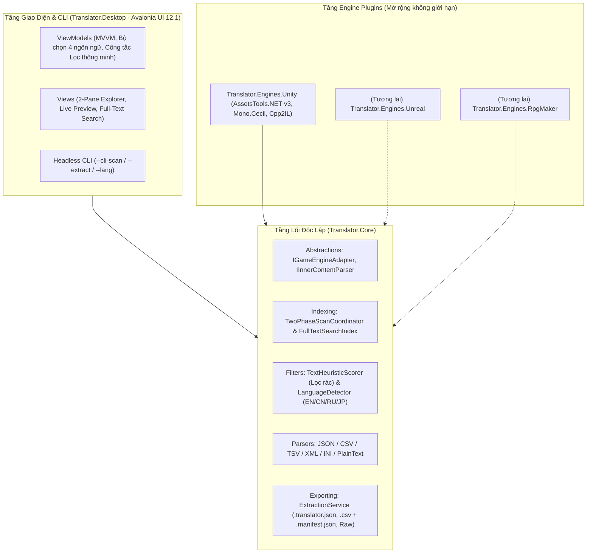

# Kiến Trúc Kỹ Thuật & Hướng Dẫn Mở Rộng Hệ Thống (`Translator`)

Tài liệu này mô tả chi tiết kiến trúc phần mềm thực tế đang vận hành, cơ chế xử lý nhị phân bên dưới từng module, công thức chấm điểm & tách ngôn ngữ, chuẩn dữ liệu định vị (`Manifest`) và **hướng dẫn từng bước để mở rộng dự án trong tương lai** (thêm chức năng **Replace/Repack**, **Gộp Master CSV**, **Font Patcher**, **AI Dịch thuật**, hoặc mở rộng sang **Unreal Engine, RPG Maker, Ren'Py, Godot**).

---

## 1. Kiến Trúc Tổng Thể (Clean Modular & Plugin Architecture)

Hệ thống được xây dựng trên nền tảng **.NET 9** và **Avalonia UI 12.1** (`WinExe` đóng gói được ra 1 file `.exe` độc lập không hiện cửa sổ Console đen), tuân thủ nguyên tắc **Đảo ngược phụ thuộc (Dependency Inversion)**:
- Tầng Giao diện (`Translator.Desktop`) và Tầng Engine (`Translator.Engines.Unity`) đều phụ thuộc vào các hợp đồng giao tiếp (Interfaces) nằm ở `Translator.Core`.
- **`Translator.Core` hoàn toàn không biết Unity hay Avalonia là gì.** Nhờ đó, khi thêm Engine mới hoặc thêm giao diện mới, toàn bộ phần lõi lọc rác, nhận diện ngôn ngữ, phân tích JSON/CSV/XML, tìm kiếm toàn văn và xuất/nhập bản dịch được tái sử dụng 100%.



---

## 2. Chi Tiết Kỹ Thuật Các Bước Xử Lý Cốt Lõi

### Bước K1: Nhận diện Game & Kiến trúc Biên dịch (`UnityGameDetector`)
Khi người dùng trỏ vào một thư mục bất kỳ:
1. Tìm kiếm thư mục dữ liệu `<GameName>_Data` (hoặc cấu trúc tương đương).
2. Xác định **Scripting Backend**:
   - **IL2CPP:** Tồn tại `GameAssembly.dll` (hoặc `.so`/`.dylib`) và `<GameName>_Data/il2cpp_data/Metadata/global-metadata.dat`.
   - **Mono:** Tồn tại `<GameName>_Data/Managed/Assembly-CSharp.dll` (hoặc các assembly `.dll` trong `Managed/`).
3. Xác định **Unity Version**: Đọc chuỗi phiên bản (ví dụ `2019.4.13f1`, `2021.3.16f1`) trực tiếp từ header nhị phân của `globalgamemanagers`, `mainData`, hoặc `data.unity3d`.

---

### Bước K2: Phân loại File bằng Chữ ký Byte (`MagicByteClassifier`)
Nhiều game đổi đuôi AssetBundle thành `.dat`, `.bin`, `.pak` hoặc bỏ trống phần mở rộng để giấu tài nguyên. Hệ thống **không chỉ dựa vào đuôi file** mà đọc 32–64 byte đầu tiên của file:

| Loại File | Cách nhận diện kỹ thuật (Magic Bytes / Header) |
| :--- | :--- |
| **Loose Text File** | Nằm trong `StreamingAssets` hoặc thư mục cấu hình, có phần mở rộng văn bản (`.json`, `.csv`, `.tsv`, `.xml`, `.txt`, `.ini`, `.yaml`) và vượt qua kiểm tra UTF-8/UTF-16 hợp lệ (không chứa chuỗi byte `0x00` nhị phân ngẫu nhiên). |
| **Unity AssetBundle** | Byte đầu bắt đầu bằng chuỗi ASCII: `UnityFS\0`, `UnityWeb\0`, `UnityRaw\0`, hoặc `UnityArchive\0` — bất kể tên hay đuôi file là gì. |
| **Unity SerializedFile (`.assets`)** | Kiểm tra cấu trúc Header Big-Endian chuẩn của Unity (`metadataSize`, `fileSize`, `formatVersion` nằm trong dải hợp lệ `5..30`, `dataOffset` < độ dài file thực tế). Áp dụng cho `resources.assets`, `sharedassets*.assets`, `level*`,... |
| **Managed Code (`.dll`)** | Header PE (`MZ` / `0x4D 0x5A`) có bảng CLI/.NET Metadata hợp lệ nằm trong thư mục `Managed/` (loại trừ sẵn các DLL hệ thống như `System.*`, `Microsoft.*`, `UnityEngine.*`, `Unity.*`, `mscorlib`, `Mono.*`, `Newtonsoft.*`). |
| **IL2CPP Metadata** | File `global-metadata.dat`: 4 byte đầu tiên (Little-Endian `uint32`) chuẩn là **`0xFAB11BAF`** (Sanity magic của Unity IL2CPP), theo sau là `int32 version` (thường từ `16` đến `35+`). |
| **File Nghi Mã Hóa (Encrypted)** | Nếu file nằm trong thư mục bundle/metadata (hoặc mang tên `global-metadata.dat` / `.bundle`) nhưng Magic Bytes không khớp chuẩn Unity (ví dụ bị XOR, AES, hoặc chèn Fake Header), bộ phân loại sinh `EncryptedFileWarning` và đẩy vào tab cảnh báo trên UI thay vì ném lỗi dừng chương trình. |

---

### Bước K3: Chi tiết Trích xuất trên 4 Tầng Dữ liệu Unity

> [!NOTE]
> **Hoạt động độc lập 100% không cần file `classdata.tpk` rời:** Do `AssetsTools.NET 3.0.5` không nhúng sẵn `classdata.tpk` và các bản build game Unity PC thường tắt TypeTree (`TypeTreeEnabled == false`), hệ thống đã tích hợp sẵn bộ giải mã nhị phân độc lập cho `TextAsset`, `MonoScript` và template cơ sở `MonoBehaviour` (vẫn tự động nạp `classdata.tpk` nếu phát hiện có đi kèm).

#### 1. `LooseFileHandler` (File văn bản lộ thiên)
- Đọc tự động nhận diện BOM (`UTF-8`, `UTF-8 BOM`, `UTF-16 LE/BE`).
- Chuyển nội dung qua `InnerContentParserRegistry` để bóc tách cấu trúc bên trong thành danh sách câu dịch.

#### 2. `TextAssetHandler` & `UnityContainerOpener` (ClassID `49` trong `.assets` & AssetBundles)
- **Quản lý RAM an toàn (`UnityContainerOpener`):** Mở container qua `FileStream`; với các gói AssetBundle nén kích thước lớn (`> 32 MB`), hệ thống giải nén ra luồng file tạm tự xóa khi đóng (`DeleteOnClose`) thay vì bung toàn bộ lên RAM, rồi đóng luồng (`Dispose`) ngay khi xử lý xong.
- Quét mọi đối tượng có `ClassID == 49` (`TextAsset`): đọc qua TypeTree hoặc bộ đọc nhị phân trực tiếp `AlignedBinaryStringScanner.TryReadBinaryTextAsset` (cặp chuỗi căn chỉnh 4-byte `m_Name` và `m_Script`).
- Kiểm tra `m_Script` qua `TextHeuristicScorer.TryDecodeReadableText` để loại bỏ các file nhị phân `.bytes` (như xương hoạt ảnh Spine `.skel.bytes`, khóa mã hóa, hay dữ liệu mesh).

#### 3. `MonoBehaviourHandler` (ClassID `114` / `ScriptableObject`)
Đây là nơi chứa dữ liệu của **I2 Localization**, **Unity Localization Tables**, và các bảng hội thoại tự định nghĩa:
1. **Khôi phục cấu trúc trường (`TypeTreeResolver`) theo chuỗi ưu tiên 3 cấp:**
   - *Cấp 1 (Nhanh nhất):* Sử dụng `TypeTree` nhúng sẵn bên trong file (thường có trong các gói `.bundle`).
   - *Cấp 2 (Dựng từ mã biên dịch + Cache đĩa):*
     - Giải mã đối tượng `MonoScript` (ClassID `115`) để lấy bộ ba `(AssemblyName, Namespace, ClassName)` ngay cả khi file bị strip TypeTree.
     - Nếu game là **Mono**: Khởi tạo `MonoCecilTempGenerator` trỏ tới thư mục `Managed/`.
     - Nếu game là **IL2CPP**: Sử dụng `Cpp2IlTempGenerator` phân tích `GameAssembly.dll` + `global-metadata.dat`, đồng thời lưu sơ đồ trường ra thư mục cache cục bộ (`.translator_cache/`) để những lần mở sau tải tức thì.
   - *Cấp 3 (Dự phòng chống mã hóa — `AlignedBinaryStringScanner`):* Nếu game xóa TypeTree VÀ mã hóa `GameAssembly.dll`, bộ quét nhị phân nhảy qua header chuẩn của `MonoBehaviour` (`m_GameObject`, `m_Enabled`, `m_Script`, `m_Name`) rồi quét các chuỗi tuân theo quy tắc căn chỉnh 4-byte của Unity (`int32 length` + `length` byte UTF-8 hợp lệ + các byte đệm `0x00` tới bội số 4 byte tiếp theo).
2. **Gom nhóm thông minh:** Các đối tượng `MonoBehaviour` có cùng `ScriptClassName` nằm trong cùng một file container (ví dụ 705 object `Text` hoặc 300 object `DialogueNode` trong `sharedassets0.assets`) được gom chung vào **1 mục `ScannedTarget`** với khóa định vị riêng cho từng object (`PathId` + `FieldOrInnerKey`).

#### 4. `CodeStringHandler` (Chuỗi cứng trong Code)
- **Với Unity Mono (`.dll`):**
  - Dùng `Mono.Cecil` duyệt qua từng `TypeDefinition` (bao gồm cả các nested compiler-generated class của Coroutine `IEnumerator` và `async/await` state machine) $\rightarrow$ `MethodDefinition` có `HasBody`.
  - Lọc các chỉ thị IL có `OpCode == OpCodes.Ldstr`, lưu chính xác `CodeTypeFullName`, `CodeMethodName` và `CodeInstructionIndex`.
- **Với Unity IL2CPP (`global-metadata.dat`):**
  - Đọc trực tiếp bảng String Literal chuẩn của IL2CPP sau `sanity = 0xFAB11BAF` và `version` (tại offset `0x08` gồm 4 trường `int32`: `stringLiteralOffset`, `stringLiteralSize`, `stringLiteralDataOffset`, `stringLiteralDataSize`).
  - Đọc từng chuỗi UTF-8 tại `stringLiteralDataOffset + dataIndex` với độ dài `length`, lưu chính xác `MetadataLiteralIndex` (`0 .. N-1`) để phục vụ tái cấu trúc bảng offset khi Replace.

---

### Bước K4: Công Thức Chấm Điểm Ưu Tiên & Lọc Rác (`TextHeuristicScorer`)
Mỗi mục file và mỗi chuỗi văn bản được tính điểm **`RelevanceScore` (thang `0..100`)** qua **2 vòng** rồi lấy trung bình cộng:

1. **Vòng 1 — Chấm điểm Tên File / Script (`ScoreTargetMetadata`):**
   - Điểm khởi tạo mặc định: **`45` điểm**.
   - Chứa từ khóa dịch thuật giá trị cao (`localization`, `localize`, `language`, `dialogue`, `story`, `subtitle`, `quest`, `stringtable`, `i2languages`...): **`+40` điểm**.
   - Chứa từ khóa nội dung/giao diện (`text`, `description`, `title`, `tooltip`, `menu`, `item`, `skill`, `tutorial`...): **`+15` điểm**.
   - Dính từ khóa hệ thống (`shader`, `tmp settings`, `navmesh`, `.atlas`, `.skel`...): ép xuống **`8..10` điểm** và gắn cờ `IsLikelyNoise = true`.
2. **Vòng 2 — Chấm chất lượng câu chữ thực tế bên trong (`EvaluateString`):**
   - Tự động loại trừ (`IsSystemNoise = true`, điểm `0..20`) các chuỗi rỗng, ký tự đơn ASCII, mã Hex/GUID, URL, đường dẫn nội bộ (`Assets/...`, `Resources/...`, `.prefab`, `.png`), biến lập trình (`m_`, `UNITY_`, `UnityEngine.`, `snake_case`, `CamelCase` dài không khoảng trắng, mã `ITEM00421`, code shader `#pragma`).
   - Với câu tự nhiên hợp lệ: khởi điểm **`50`**, có khoảng trắng (`+20`, từ 3 khoảng trắng trở lên `+10` nữa), có ký tự đa ngôn ngữ/CJK (`+20`), có dấu câu `. ! ? , : ; …` (`+10`), có thẻ hội thoại game `<color` hoặc `{0}` (`+10`).
3. **Điểm Tổng Hợp hiển thị trên Giao diện (`TwoPhaseScanCoordinator`):**
   - Nếu file không có câu hợp lệ nào (`ValidEntryCount == 0`): ép điểm $\le 15$ và đánh dấu là rác.
   - Ngược lại: $\text{RelevanceScore} = \text{Clamp}\left(\frac{\text{MetadataScore} + \text{AvgValidEntryScore}}{2}, 10, 100\right)$.
   - Trên giao diện Desktop, công tắc **`UseSmartFilter` ("Đang bật Lọc thông minh — Ẩn rác hệ thống")** mặc định **BẬT (màu xanh)** để chỉ hiển thị các file chứa câu thoại thật sự, sắp xếp giảm dần theo điểm số. Khi gạt tắt sang màu xám, toàn bộ file và dòng hệ thống sẽ hiện ra để kiểm tra thủ công.

---

### Bước K5: Nhận Diện & Cô Lập 4 Ngôn Ngữ (`LanguageDetector`)
Nhiều game Unity nhồi chung 4–6 ngôn ngữ vào cùng một bảng CSV hoặc một `MonoBehaviour` (ví dụ `ID,TC,EN,JP,SC,RU`), thậm chí có những dòng câu thoại tiếng Trung chứa dấu phẩy `,` không bọc ngoặc kép làm lệch cột ở vài hàng. Bộ `LanguageDetector` hỗ trợ lọc chính xác **4 ngôn ngữ nguồn (`1. English`, `2. China`, `3. Russian`, `4. Japan`)** hoặc **`Tất cả ngôn ngữ`** qua quy trình 3 tầng:

1. **Làm sạch thẻ lệnh & Phân tích Bảng mã Unicode:**
   - Tách bỏ tạm thời các thẻ Rich Text (`<color=#...>`, `</color>`) và biến giữ chỗ (`{0}`, `%s`, `\n`) trước khi đếm ký tự.
   - Phân tích tỷ lệ chữ cái: **Cyrillic** (`U+0400..U+052F` $\rightarrow$ `Russian`), **Kana** (`Hiragana`/`Katakana` $\rightarrow$ `Japanese`), **CJK Ideographs** + trợ từ ngữ pháp đặc trưng tiếng Trung (`的, 了, 嗎/吗, 呢, 吧, 這/这, 們/们, 經/经, 無/无...` $\rightarrow$ `Chinese`), **Latin** (`A..Z, a..z` $\rightarrow$ `English`), và tách riêng **Hangul** (`Other`) để không lọt nhầm tiếng Hàn vào 4 ngôn ngữ trên.
2. **Bỏ phiếu thống trị theo Cột / Trường (`Column & Slot Dominance Voting`):**
   - Gom nhóm các câu theo vị trí cấu trúc (`table_col:N` cho bảng CSV/TSV, `mb:path` cho trường `MonoBehaviour`, `json_leaf:prop` cho JSON).
   - Bầu chọn ngôn ngữ chủ đạo của từng cột (yêu cầu số hàng chứa Kana `JapaneseKanaRows >= PureCjkRows` mới kết luận cột tiếng Nhật, tránh trường hợp 1 dòng tiếng Nhật bị lệch dấu phẩy tràn sang cột tiếng Trung làm sai cả cột).
   - Lưu ý: Khi một ô trong cột có chữ cái thuộc hệ chữ hoàn toàn khác với ngôn ngữ chủ đạo của cột (ví dụ dòng bị lệch dấu phẩy khiến chữ tiếng Nhật nhảy sang ô cột tiếng Trung), bộ phân loại ưu tiên giữ đúng ngôn ngữ thực chất của ô đó để file CSV xuất ra **tinh khiết 100% một ngôn ngữ duy nhất**.
3. **Suy luận từ Nhãn Cột / Tên File (`Tag Hint Fallback`):**
   - Với các từ ngắn mơ hồ (ví dụ vài ký tự Kanji thuần không kèm Kana trong file tên ` localize_ja.json` hoặc cột header `JP`), hệ thống đối chiếu hậu tố mã ngôn ngữ (`en`, `zh/cn/tc/sc`, `ru`, `ja/jp`) để gán đúng ngôn ngữ.

---

### Bước K6: Phân tích Cấu trúc Lồng (`IInnerContentParser`)
Khi một `LooseFile` hoặc `TextAsset` chứa dữ liệu có cấu trúc, `InnerContentParserRegistry` tự động chọn Parser phù hợp và sinh khóa `InnerKey` có thể đảo ngược (reversible):

| Định dạng | Ví dụ Nội dung gốc | `InnerKey` được sinh ra | Ý nghĩa khi Replace sau này |
| :--- | :--- | :--- | :--- |
| **JSON** | `{"ui": {"btn": ["Play", "Quit"]}}` | `$.ui.btn[0]`, `$.ui.btn[1]` | Parse lại cây `JsonNode`, tìm đúng đường dẫn và thay giá trị chuỗi mà giữ nguyên format/số/boolean khác. |
| **CSV / TSV** *(Có Header hoặc Không Header)* | `ID,EN,JP`<br>`BTN_1,"New Game","..."`<br>*(hoặc bảng 6 cột không header)* | `csv:row=1;col=1;key=BTN_1;hdr=EN`<br>*(hoặc `csv:row=0;col=2;key=90401_1`)* | Bộ đọc CSV nhận diện dấu ngoặc kép `"..."`, tự bỏ qua cột ID/số thuần túy; khi Replace mở lại đúng tọa độ `(row, col)` để thay đúng ô ngôn ngữ đã dịch mà giữ nguyên các cột ngôn ngữ còn lại. |
| **XML** | `<loc><str id="a">Hello</str></loc>` | `xml:/loc[0]/str[0]#text` (hoặc `@value`) | Dùng `XDocument` định vị chính xác node thứ `i` và sửa `.Value` mà không làm hỏng thẻ XML. |
| **INI / Key-Value** | `[Menu]`<br>`Start = Start Game` | `ini:[Menu]Start` | Hỗ trợ khoảng trắng quanh dấu `=`, thay phần vế phải tại đúng section `[Menu]`. |
| **Plain Text** | Nhiều dòng hội thoại thuần | `line:0`, `line:1`, ... | Thay thế đúng dòng thứ `i` và nối lại bằng ký tự xuống dòng gốc (`\r\n` hoặc `\n`). |

---

### Bước K7: Cơ chế Quét 2 Pha & Chỉ mục Toàn văn (`TwoPhaseScanCoordinator`)
1. **Pha 1 (`Fast Discovery`):** Quét cấu trúc thư mục, header `.assets`/`.bundle`, tạo danh sách `ScannedTarget` kèm điểm ưu tiên sơ bộ theo tên và kích thước. Giao diện hiển thị ngay danh sách chỉ sau vài giây.
2. **Pha 2 (`Background Indexing`):** Chạy bất đồng bộ dưới nền với `CancellationToken` và `IProgress<ScanProgress>`. Giải mã `TextEntry`, chạy `LanguageDetector.AssignLanguages` để thống kê sẵn số câu theo từng ngôn ngữ (`LanguageEntryCounts`), cập nhật điểm `RelevanceScore` chính xác và nạp vào `FullTextSearchIndex` (giới hạn tối đa `512 KB` văn bản chỉ mục/mục để game 30 GB vẫn tốn cực ít RAM). Nhờ đó người dùng đổi ngôn ngữ hoặc gõ tìm câu thoại là giao diện lọc tức thì không cần quét lại.

---

## 3. Chuẩn Cấu Trúc File Xuất (`Manifest` & `TranslationPackage`)

Hệ thống `ExtractionService` hỗ trợ 3 chế độ xuất linh hoạt:
1. **JSON chuẩn (`.translator.json`):** Gói trọn cả câu gốc, câu dịch và tọa độ nhị phân `EntryLocation` trong 1 file.
2. **Bảng CSV (`.csv` chuẩn UTF-8 BOM mở trực tiếp trên Excel không lỗi font tiếng Việt):** Nếu người dùng chỉ tick xuất `.csv` (bỏ tick `.translator.json`), hệ thống tự động sinh kèm file siêu dữ liệu ẩn nhẹ **`.manifest.json`** bên cạnh để Giai đoạn 2 (Replace) vẫn có đủ 100% tọa độ `PathID`, `SHA-256` và `EntryLocation` khi nạp lại file `.csv` đã dịch.
3. **Tự động khử trùng tên & Bỏ qua file rỗng theo ngôn ngữ:** Nếu trong cùng 1 `.assets` có nhiều `TextAsset` trùng tên (ví dụ hai asset cùng tên `en`), file xuất tự động gắn hậu tố `_PathID` để không bao giờ ghi đè mất dữ liệu của nhau. Khi chọn lọc riêng 1 ngôn ngữ (ví dụ `1. English`), những file có `0` câu tiếng Anh sẽ tự động được bỏ qua không sinh file CSV rỗng.

Schema thực tế của `TranslationPackage` (`.translator.json` / `.manifest.json`):

```json
{
  "schemaVersion": "1.0",
  "engine": "Unity",
  "engineVersion": "2021.3.16f1",
  "scriptingBackend": "IL2CPP",
  "targetId": "MyGame_Data/resources.assets::TextAsset::1452",
  "displayName": "Localization_EN",
  "sourceKind": "TextAsset",
  "containerRelativePath": "MyGame_Data/resources.assets",
  "bundleMemberName": null,
  "originalContainerSha256": "E3B0C44298FC1C149AFBF4C8996FB924...",
  "innerFormat": "Json",
  "entries": [
    {
      "id": "entry_0001",
      "key": "$.menu.start_game",
      "context": "TextAsset 'Localization_EN' (PathID=1452) | JSON $.menu.start_game",
      "originalText": "Start New Game",
      "translatedText": "",
      "relevanceScore": 70,
      "isSystemNoise": false,
      "language": "English",
      "location": {
        "containerRelativePath": "MyGame_Data/resources.assets",
        "bundleMemberName": null,
        "assetClassId": 49,
        "pathId": 1452,
        "scriptClassName": null,
        "fieldOrInnerKey": "$.menu.start_game",
        "codeTypeFullName": null,
        "codeMethodName": null,
        "codeInstructionIndex": null,
        "metadataLiteralIndex": null
      }
    }
  ]
}
```

Ngoài ra ở thư mục gốc nơi xuất luôn có file mục lục tổng **`manifest.project.json`** (`ProjectExtractionManifest`) liệt kê toàn bộ các mục đã trích xuất của dự án game đó.

---

## 4. Đóng Gói Độc Lập (`.exe`) & Chế Độ Dòng Lệnh (CLI)

Dự án `Translator.Desktop` được cấu hình `OutputType = WinExe` kết hợp `AttachConsole(-1)` trên Windows trong `Program.cs`:
- **Khi nháy đúp mở bình thường:** Khởi chạy thẳng cửa sổ đồ họa Avalonia UI mượt mà, không bật cửa sổ Console đen phía sau.
- **Khi truyền tham số trên Terminal:** Tự động gắn luồng xuất vào Terminal hiện tại để chạy tự động hóa không cần giao diện:
  ```powershell
  # Quét và trích xuất riêng tiếng Anh qua CLI
  Translator.Desktop.exe --cli-scan "D:\Games\MyUnityGame" --extract "D:\Output\Dich" --lang en
  ```
  *(Tham số `--lang` hỗ trợ: `en`, `cn`, `ru`, `jp`, `all`).*
- **Lệnh đóng gói ra 1 file `.exe` duy nhất tự chứa `.NET 9` (`~46 MB`, không kèm rác `.pdb`):**
  ```powershell
  dotnet publish src/Translator.Desktop/Translator.Desktop.csproj -c Release -r win-x64 --self-contained true -p:PublishSingleFile=true -p:DebugType=None -p:DebugSymbols=false -o publish
  ```

---

## 5. Hướng Dẫn Kỹ Thuật Để Mở Rộng Trong Tương Lai

### Mở rộng A: Triển khai Giai đoạn 2 — Chức năng Replace, Gộp Master CSV & Backup Nguyên Tử
Khi triển khai tính năng nạp bản dịch và ghi đè vào game, thực hiện theo 4 bước kỹ thuật trên nền tảng sẵn có:

1. **Tạo `BackupVaultService` trong `Translator.Core`:**
   - Trước khi sửa bất kỳ `containerRelativePath` nào, kiểm tra thư mục `<GameRoot>/.translator_backup/<containerRelativePath>`.
   - Nếu chưa tồn tại, copy nguyên bản file gốc vào kho backup và lưu file `backup_index.json` chứa mã `SHA-256` của file gốc.
   - **Quy tắc bất biến:** Mọi thao tác Replace về sau luôn đọc dữ liệu nền từ **file gốc bất biến trong `.translator_backup/`** (không đọc chồng lên file đã bị sửa trước đó), áp dụng bản dịch mới, ghi ra `<file>.translator.tmp`, kiểm tra hoàn tất rồi mới thực hiện `File.Move(tmp, target, overwrite: true)`. Hỗ trợ nút **Khôi phục gốc 1 chạm (Restore Original)**.
2. **Hỗ trợ nạp cả Thư mục nhiều file CSV/JSON lẫn Tùy chọn `Master.csv` (1 file gộp duy nhất):**
   - Nếu người dùng bật tùy chọn xuất gộp `Master.csv`, thêm cột đầu tiên `TargetId` bên cạnh `Id, Key, OriginalText, TranslatedText`. Khi Import ngược lại `Master.csv`, bộ đọc gom nhóm theo `TargetId` + đối chiếu `manifest.project.json` / `.manifest.json` để tự động phân phối câu dịch trả về đúng từng file tài nguyên gốc.
3. **Tạo interface `IGameEnginePatcher` trong `Translator.Core/Abstractions/`:**
   ```csharp
   public interface IGameEnginePatcher
   {
       Task<PatchReport> ApplyTranslationsAsync(
           GameProfile profile,
           IReadOnlyList<TranslationPackage> packages,
           IProgress<ScanProgress>? progress = null,
           CancellationToken cancellationToken = default);
   }
   ```
4. **Viết 4 bộ Replacer tương ứng trong `Translator.Engines.Unity` dựa vào `entry.Location`:**
   - **`LooseFile`:** Mở file gốc từ Backup $\rightarrow$ gọi `IInnerContentParser` tái tạo nội dung theo `FieldOrInnerKey` $\rightarrow$ ghi ra file đích đúng Encoding ban đầu.
   - **`TextAsset` (`AssetClassId == 49`):** Mở file `.assets`/`.bundle` từ Backup, tìm object theo `PathId`, tái tạo nội dung văn bản (chỉ thay đúng ô `(row, col)` hoặc đường dẫn JSON đã dịch, bảo toàn nguyên vẹn các cột ngôn ngữ khác), cập nhật mảng byte `m_Script` và ghi lại (nếu là Bundle thì repack nén `LZ4`).
   - **`MonoBehaviour` (`AssetClassId == 114`):** Mở `GetBaseField()` theo `PathId`, đi theo đường dẫn `FieldOrInnerKey` (ví dụ `mSource.mTerms.Array[15].Languages.Array[0]`), gán `.AsString = entry.TranslatedText`, rồi ghi lại object.
   - **`CodeString`:**
     - *Mono DLL:* Dùng `Mono.Cecil` mở `AssemblyDefinition` từ Backup, định vị `CodeTypeFullName` $\rightarrow$ `CodeMethodName` $\rightarrow$ chỉ thị `ldstr` tại `CodeInstructionIndex`, gán `instruction.Operand = entry.TranslatedText` và ghi lại DLL.
     - *IL2CPP `global-metadata.dat`:* Đọc mảng `StringLiteral` gốc từ Backup, thay chuỗi tại `MetadataLiteralIndex` bằng UTF-8 tiếng Việt, xây lại vùng đệm `StringLiteralData`, tính lại `(length, dataIndex)` và cộng độ lệch `deltaBytes` cho các trường offset nằm sau `stringLiteralDataOffset` trong header.

---

### Mở rộng B: Thêm một Game Engine Mới (VD: Unreal Engine, RPG Maker, Ren'Py)
Nhờ thiết kế Plugin, **không cần sửa code của `Translator.Core`**. Quy trình chỉ gồm 3 bước:

1. **Tạo Project mới:** Ví dụ `src/Translator.Engines.RpgMaker/Translator.Engines.RpgMaker.csproj` tham chiếu tới `Translator.Core`.
2. **Implement interface `IGameEngineAdapter`:**
   - `EngineName => "RPG Maker MV/MZ"`
   - `DetectGameAsync(folderPath, ct)`: Kiểm tra sự tồn tại của `www/data/System.json` (MV) hoặc `data/System.json` + `Game.rmmzproject` (MZ).
   - `DiscoverTargetsAsync(profile, progress, ct)`: Quét các file `Map*.json`, `CommonEvents.json`, `Actors.json`, `Items.json`.
   - `ExtractTargetAsync(profile, target, ct)`: Lọc đúng mã lệnh sự kiện hội thoại của RPG Maker (Event Code `401` lời thoại, `102` lựa chọn, `101` tên nhân vật).
3. **Đăng ký Adapter vào `TwoPhaseScanCoordinator` trong `Translator.Desktop`:**
   - Thêm `new RpgMakerEngineAdapter()` vào danh sách `IGameEngineAdapter`. Toàn bộ cơ chế quét 2 pha, lọc rác, tách 4 ngôn ngữ, tìm kiếm toàn văn, xem trước và xuất `.translator.json` / `.csv` sẽ hoạt động ngay lập tức với Engine mới!

---

### Mở rộng C: Thêm Định dạng Cấu trúc Lồng Mới (VD: YAML, SQLite, MessagePack)
1. Tạo class mới trong `Translator.Core/Parsers/` (ví dụ `YamlContentParser : IInnerContentParser`).
2. Cài đặt thuộc tính `Format` và 2 hàm:
   - `CanParse(string fileNameOrHint, ReadOnlySpan<char> content)`: Kiểm tra nhanh cú pháp đầu vào.
   - `Parse(string content)`: Trả về `IReadOnlyList<ParsedTextNode>` gồm `(InnerKey, Value, Context)`.
3. Đăng ký class này vào `InnerContentParserRegistry` — ngay lập tức cả `LooseFileHandler` lẫn `TextAssetHandler` đều tự động biết cách bóc tách định dạng mới.

---

### Mở rộng D: Việt Hóa Font Chữ Unity & Kết nối AI Dịch Thuật Nhẹ Mượt
1. **Module Font Patcher (`Translator.Engines.Unity/Fonts/`):**
   - Quét các object có `AssetClassID.Font` (`128` - Dynamic TTF/OTF) và `MonoBehaviour` có script `TMP_FontAsset` (TextMeshPro).
   - Với `Font (128)`: Cho phép chọn file `.ttf` tiếng Việt trên máy và bơm trực tiếp vào mảng byte `m_FontData`.
   - Với `TMP_FontAsset`: Cho phép import gói `TMP_FontAsset` tiếng Việt cùng phiên bản Unity hoặc gắn vào mảng `m_FallbackFontAssetTable` của font gốc để xóa lỗi ô vuông `□□□`.
2. **Module AI Translator & In-App Editor (`Translator.Core/Translation/`):**
   - Kết nối nhẹ qua HTTP API tới Cloud LLM (**Gemini / OpenAI / DeepL**) hoặc cổng cục bộ **Ollama** (giữ cho file `.exe` luôn gọn nhẹ dưới 50 MB mà không phải nhúng model vài GB).
   - Trước khi gửi `originalText` cho AI, chạy qua lớp **`TagProtector`** khóa toàn bộ thẻ điều khiển (`<color=#...>`, `</color>`, `<size=...>`, `{0}`, `{player_name}`, `\n`) thành token cố định (`[[T0]]`, `[[T1]]`) kèm bảng **Từ điển tên riêng (`Glossary`)**, sau đó khôi phục nguyên vẹn thẻ lệnh khi nhận bản dịch về.
