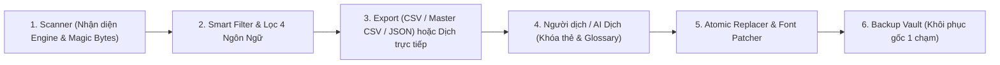

# Nghiên Cứu, Quy Trình Thực Chiến & Lộ Trình Phát Triển Tool Việt Hóa Game (`Translator`)

Tài liệu này tổng hợp kiến trúc nền tảng, cơ chế lưu trữ ngôn ngữ & font chữ trong game Unity, quy trình Việt hóa thực chiến chuẩn của cộng đồng dịch thuật và **tiến độ thực thi theo 5 giai đoạn** của dự án **Translator** (từ công cụ chuyên sâu cho Unity tiến tới **Ứng dụng Dịch Game Tự Động Đa Engine**).

> Xem chi tiết thiết kế mã nguồn thực tế, công thức chấm điểm/tách ngôn ngữ và hướng dẫn lập trình mở rộng tại [ARCHITECTURE.md](./ARCHITECTURE.md).

---

## 1. Tổng Quan Luồng Hoạt Động Khép Kín (Core Workflow)

Mô hình chuẩn của một nền tảng Localization chuyên nghiệp (**Scan $\rightarrow$ Filter $\rightarrow$ Extract/Translate $\rightarrow$ Font Patch $\rightarrow$ Atomic Repack**):

1. **Scanner (Bộ dò tìm 2 pha):** Người dùng chọn thư mục gốc của game. Tool tự nhận diện Engine (Unity Mono, Unity IL2CPP, tương lai là Unreal, RPG Maker, Ren'Py...) và đọc chữ ký byte đầu file (**Magic Bytes**) để bắt trọn cả các gói dữ liệu bị đổi đuôi hoặc cảnh báo file bị mã hóa.
2. **Smart Filter & Language Isolation (Bộ lọc rác & Cô lập ngôn ngữ):** Tự động chấm điểm ưu tiên (`0..100`), ẩn rác hệ thống (biến code, shader, đường dẫn) và tách riêng đúng 1 ngôn ngữ cần dịch (`English`, `China`, `Russian`, `Japan`) ngay cả khi game gộp chung 5–6 thứ tiếng trong cùng 1 bảng CSV.
3. **Export / In-App Studio:** Xuất ra bảng `.csv` (chuẩn UTF-8 BOM mở trực tiếp trên Excel kèm `.manifest.json` giữ tọa độ), `.translator.json`, hoặc tiến tới dịch trực tiếp ngay trên bảng ảo hóa của phần mềm.
4. **Atomic Replacer & Backup Vault:** Tự động sao lưu bất biến file gốc vào `.translator_backup/` (đối chiếu `SHA-256`), sau đó đóng gói ngược câu tiếng Việt vào đúng tọa độ nhị phân của game và cho phép khôi phục game gốc chỉ với 1 cú nhấp chuột.

---

## 2. Giải Phẫu 4 Tầng Lưu Trữ Văn Bản Trong Game Unity

Các nhà phát triển game Unity thường lưu chữ ở 4 tầng dưới đây (theo độ khó kỹ thuật tăng dần — **tất cả 4 tầng này hiện đều đã được Giai đoạn 1 hỗ trợ quét & bóc tách hoàn chỉnh**):

### Tầng 1: File lộ thiên (Loose Files) — *Dễ nhất*
Nhiều game đặt thẳng file ngôn ngữ bên ngoài trong `<Tên_Game>_Data/StreamingAssets/` hoặc thư mục cấu hình:
- **Định dạng:** `.json`, `.csv`, `.tsv`, `.xml`, `.yaml`, `.txt`, `.ini`.
- **Cách xử lý:** Tự động nhận diện bảng mã (`UTF-8`, `UTF-8 BOM`, `UTF-16 LE/BE`), bóc tách cấu trúc bên trong thành từng dòng kèm khóa định vị để ghi đè chính xác mà không làm hỏng cấu trúc cú pháp.

### Tầng 2: `TextAsset` nằm trong `.assets` / `AssetBundles` — *Phổ biến nhất*
Unity đóng gói tài nguyên vào các file nhị phân trong `<Tên_Game>_Data/`:
- Các file `resources.assets`, `sharedassets0.assets`, `level0`,... hoặc gói nén `LZ4`/`LZMA` trong `StreamingAssets/aa/` (Addressables), `.bundle`, `.unity3d`.
- Bên trong chứa đối tượng **`TextAsset` (ClassID: `49`)** với trường `m_Name` và mảng byte `m_Script` (chứa nội dung `.txt`, `.json`, `.csv` bên trong).
- **Cách xử lý:** Giải nén qua Stream (tránh tràn RAM với bundle lớn), kiểm tra loại bỏ `.bytes` nhị phân (như xương hoạt ảnh Spine `.skel.bytes`), phân tích cấu trúc bảng/JSON bên trong và lưu sẵn `PathID` + tọa độ ô `(row, col)` để Replace.

### Tầng 3: `MonoBehaviour` (`ScriptableObject`) — *Rất phổ biến ở game dùng Plugin đa ngôn ngữ*
Các plugin nổi tiếng như **I2 Localization**, **Unity Localization Package**, hoặc hội thoại tự viết thường lưu dưới dạng **`MonoBehaviour` (ClassID: `114`)**.
- Cấu trúc nhị phân của `MonoBehaviour` phụ thuộc vào code riêng của từng game (**TypeTree**) và thường bị ẩn đi khi xuất bản game PC (`Stripped TypeTree`).
- **Cách xử lý:** Khôi phục sơ đồ biến theo 3 tầng: (1) TypeTree nhúng sẵn $\rightarrow$ (2) Dịch ngược từ `Managed/*.dll` (`Mono.Cecil`) hoặc `GameAssembly.dll` + `global-metadata.dat` (`Cpp2IL` kèm lưu **Disk Cache** `.translator_cache/`) $\rightarrow$ (3) Bộ quét chuỗi nhị phân căn chỉnh 4-byte dự phòng nếu code bị mã hóa. Đồng thời tự động gom nhóm hàng trăm object cùng Class vào chung 1 mục để dễ dịch.

### Tầng 4: Chuỗi viết cứng trong Code (Hardcoded Strings) — *Nâng cao*
Khi lập trình viên viết thẳng chữ vào code C# (ví dụ `text.text = "Press Any Key";`), chữ nằm trong mã thực thi thay vì `.assets`:
1. **Unity Mono (`<Tên_Game>_Data/Managed/Assembly-CSharp.dll`):** Quét toàn bộ chỉ thị IL `ldstr` (bao gồm cả bên trong các hàm Coroutine / Async State Machine do trình biên dịch sinh ngầm) và lưu tọa độ `(Type, Method, InstructionIndex)`.
2. **Unity IL2CPP (`<Tên_Game>_Data/il2cpp_data/Metadata/global-metadata.dat`):** Đọc trực tiếp bảng `StringLiteral` (bắt đầu sau magic `0xFAB11BAF`), lưu chỉ số `MetadataLiteralIndex` để khi Replace tự động tính lại bảng độ dài và dịch chuyển offset header.

---

## 3. Công Nghệ & Thư Viện Cốt Lõi (Tech Stack)

> [!IMPORTANT]
> **Kiến trúc chính thức đã triển khai:** Dự án sử dụng **C# (`.NET 9`) + `Avalonia UI 12.1`** (`WinExe` đóng gói ra 1 file `.exe` độc lập ~46 MB chạy ngay trên mọi máy Windows x64, không tốn RAM như các nền tảng nhúng trình duyệt Electron, đồng thời tích hợp sẵn chế độ dòng lệnh Headless CLI).

### Bảng Công Nghệ Đang Vận Hành Trong Dự Án (`Translator.sln`)

| Thành phần | Thư viện đang sử dụng | Vai trò trong hệ thống |
| :--- | :--- | :--- |
| **Nền tảng & Giao diện Desktop** | **`.NET 9.0`** + **`Avalonia UI 12.1.4`** + **`CommunityToolkit.Mvvm 8.4.2`** | Giao diện Dark Mode hiện đại có **UI Virtualization** (hiển thị mượt hàng chục nghìn câu thoại với vài chục MB RAM), đóng gói Single-File `.exe`. |
| **Đọc & Đóng gói `.assets` / `.bundle`** | **[AssetsTools.NET 3.0.5](https://github.com/nesrak1/AssetsTools.NET)** *(kèm bộ đọc nhị phân độc lập)* | Nhân xử lý đứng sau **UABEA**. Kết hợp bộ giải mã nhị phân tự viết giúp đọc `TextAsset`/`MonoScript`/`MonoBehaviour` độc lập 100% không cần file `classdata.tpk` rời. |
| **Xử lý Unity Mono (`.dll` & TypeTree)** | **`Mono.Cecil 0.11.6`** + **`AssetsTools.NET.MonoCecil 3.0.4`** | Khôi phục TypeTree cho game Mono và quét/vá chỉ thị chuỗi `ldstr` trong `Assembly-CSharp.dll`. |
| **Xử lý Unity IL2CPP (`global-metadata.dat`)** | **`AssetsTools.NET.Cpp2IL 3.0.4`** *(LibCpp2IL)* + Bộ đọc nhị phân `0xFAB11BAF` | Khôi phục TypeTree cho game IL2CPP (kèm cache ổ cứng `.translator_cache/`) và trích xuất bảng `StringLiteral`. |

*(Tham khảo thêm ở hệ sinh thái Python: **[UnityPy](https://github.com/K0lb3/UnityPy)** cũng là một thư viện mã nguồn mở rất tốt để đối chiếu logic cấu trúc object của Unity khi nghiên cứu).*

---

## 4. Bài Toán Lỗi Font Chữ Tiếng Việt (Ô Vuông `□□□`) & Hướng Giải Quyết

Khi Replace text tiếng Việt vào game Unity, **90% trường hợp lỗi hiển thị** đến từ việc các ký tự có dấu (`ă, â, đ, ê, ô, ơ, ư, ẫ, ệ, ử...`) bị hiện thành ô vuông `□` hoặc biến mất:
- **Nguyên nhân:** Font gốc của game tiếng Anh/Nhật/Trung (thường là **Dynamic Font `.ttf/.otf` ClassID `128`** hoặc **TextMeshPro `TMP_FontAsset`**) đã bị cắt bỏ bộ ký tự tiếng Việt để tiết kiệm bộ nhớ. Riêng `TMP_FontAsset` vẽ chữ từ một tấm ảnh Atlas (`Texture2D`) kèm bảng tọa độ `m_GlyphTable` và `m_CharacterTable`.
- **Giải pháp theo lộ trình:**
  - *Trước mắt (Khi có Giai đoạn 2 Replace):* Thực hiện **"Test mồi 3 câu"** ngay đầu game để kiểm tra xem font gốc đã hỗ trợ sẵn Unicode tiếng Việt chưa.
  - *Giai đoạn 3 (Auto Font Patcher):* Tích hợp tính năng tự động quét kiểm tra độ phủ ký tự tiếng Việt của mọi Font trong game, cho phép bơm trực tiếp file `.ttf` tiếng Việt vào `Font (128)` hoặc gắn Fallback / thay thế Atlas cho `TMP_FontAsset`.

---

## 5. Quy Trình Việt Hóa Thực Chiến Chuẩn (Kinh Nghiệm Tối Ưu Công Sức)

Khi sử dụng **Translator** để Việt hóa một tựa game thực tế có hàng trăm file tài nguyên, quy trình chuẩn tối ưu nhất gồm **5 bước**:

1. **Bước 1 — Chọn lọc theo Quy tắc 80/20 & Điểm ưu tiên (`RelevanceScore`):**
   - Bật **Lọc thông minh** và chọn đúng ngôn ngữ gốc cần dịch (ví dụ `1. English`).
   - Ưu tiên nhìn các mục có **`Điểm: 70 – 100`** ở đầu danh sách (như `Localize`, `TextData`, `Dialogue`, `AchievementData`, `UI Text`). Tránh dịch ngay các file nháp/test nhà làm game bỏ quên (như `testData`, `Temp...`) để tiết kiệm 30–40% công sức.
2. **Bước 2 — "Test mồi 3 câu" trước khi dịch hàng loạt:**
   - Sửa thử 2–3 câu ở Menu đầu game thành câu có đủ dấu khó tiếng Việt (`"Bắt đầu — Kiểm tra dấu: ẫ, ệ, ử, đ"`), bấm **Replace** vào game và mở game kiểm tra ngay xem (1) có đúng file game đang đọc thật không và (2) font chữ có bị ô vuông `□□□` không.
3. **Bước 3 — Lập bảng Từ điển Tên riêng & Xưng hô (`Glossary`):**
   - Chốt trước ~30–100 tên nhân vật, địa danh, kỹ năng và cặp đại từ xưng hô (`Anh - Em`, `Ta - Ngươi`, `Tôi - Cậu`) để giữ văn phong nhất quán từ đầu đến cuối game.
4. **Bước 4 — Dịch nội dung (AI Dịch khóa thẻ lệnh + Người hiệu đính):**
   - Có thể làm trên bảng CSV gộp (`Master.csv`), nền tảng nhóm như *ParaTranz*, hoặc trực tiếp trên trình dịch tích hợp của phần mềm (Giai đoạn 4), luôn đảm bảo giữ nguyên các mã điều khiển `<color=...>`, `{0}`, `\n`.
5. **Bước 5 — Replace & Kiểm thử trong game (In-Game QA):**
   - Mở game kiểm tra lỗi tràn khung nút bấm (do tiếng Việt thường dài hơn tiếng Anh ~25%), sửa các từ ngắn đa nghĩa, và dùng ô **Tìm kiếm toàn văn (Full-Text Search)** của tool để gõ truy lùng bất kỳ câu tiếng Anh nào còn sót lại trên màn hình.

---

## 6. Lộ Trình 5 Giai Đoạn & Trạng Thái Hiện Tại

### Giai đoạn 1: Unity Full-Source Scanner, Smart Filter & 4-Language Extractor — *(ĐÃ HOÀN THÀNH 100%)*
- [x] Tự động nhận diện phiên bản Unity và kiến trúc **Mono / IL2CPP**.
- [x] Quét trọn bộ **4 tầng lưu trữ** (`Loose Files`, `TextAsset`, `MonoBehaviour` tự giải Stripped TypeTree + Disk Cache IL2CPP, và `Hardcoded Strings` trong `.dll` + `global-metadata.dat`).
- [x] Phân loại **Magic Bytes** bắt bundle giấu đuôi và gom cảnh báo file bị mã hóa.
- [x] Quét bất đồng bộ **2 pha** kèm ô **Tìm kiếm xuyên nội dung (Full-Text Search)**.
- [x] Chấm điểm ưu tiên (`0..100`) & công tắc **Lọc thông minh (`UseSmartFilter`)**.
- [x] Tự động nhận diện & tách riêng **4 ngôn ngữ (`1. English`, `2. China`, `3. Russian`, `4. Japan`)**, xử lý sạch cả các bảng CSV đa ngôn ngữ không header hoặc bị lệch cột dấu phẩy.
- [x] Xuất chuẩn `.translator.json`, `.csv` (UTF-8 BOM kèm `.manifest.json`), `manifest.project.json`, tùy chọn `Raw`, chế độ CLI (`--cli-scan`, `--extract`, `--lang`) và đóng gói 1 file `Translator.Desktop.exe` độc lập.

### Giai đoạn 2: Bộ Ghi Đè Ngược, Gộp Master CSV & Kho Sao Lưu Nguyên Tử *(Giai đoạn tiếp theo)*
- [ ] **Kho sao lưu bất biến (`.translator_backup/`):** Tự động backup file gốc kèm kiểm tra `SHA-256` trước khi ghi đè; nút **Khôi phục gốc 1 chạm (Restore Original)**.
- [ ] **Tùy chọn Gộp 1 File `Master.csv`:** Cho phép xuất toàn bộ mục đã chọn ra 1 file CSV duy nhất để dịch cá nhân / dịch AI cực nhanh, và tự động tách trả về đúng từng file tài nguyên khi nạp lại.
- [ ] **Atomic Replacer cho cả 4 tầng Unity:** Ghi đè an toàn qua file tạm `.translator.tmp` cho `LooseFile`, `TextAsset` (`.assets` & repack nén `LZ4` cho `.bundle`), `MonoBehaviour`, và `CodeString` (vá `ldstr` trong `.dll` & tái cấu trúc bảng offset `global-metadata.dat`).

### Giai đoạn 3: Tự Động Hóa Việt Hóa Font Chữ (`Auto Font Patcher`)
- [ ] Quét danh sách font trong game và kiểm tra tự động độ phủ bảng chữ cái tiếng Việt Unicode.
- [ ] Bơm trực tiếp font `.ttf` / `.otf` tiếng Việt vào `Font (ClassID 128)` và hỗ trợ thay thế / gắn Fallback Atlas cho **`TextMeshPro (TMP_FontAsset)`**.

### Giai đoạn 4: Trình Biên Tập Tích Hợp & Trung Tâm Dịch AI (`AI Localization Studio`)
- [ ] **Trình biên tập trực tiếp siêu nhẹ (`In-App Translation Editor`):** Tận dụng UI Virtualization để sửa bản dịch, lọc câu chưa dịch, cảnh báo câu quá dài gây tràn khung ngay trên phần mềm mà không làm nặng máy.
- [ ] **Kết nối AI Cloud & Offline gọn nhẹ:** Gọi API tốc độ cao (**Gemini, OpenAI, DeepL**) hoặc kết nối cổng nội bộ **Ollama** (không nhúng model nặng vào `.exe`), đi kèm lớp khóa thẻ lệnh **`TagProtector`** (`<color>`, `{0}`, `\n`) và bảng từ điển **`Glossary`**.

### Giai đoạn 5: Mở Rộng Hệ Sinh Thái Đa Game Engine (`Multi-Engine Adapters`)
Tận dụng giao diện `IGameEngineAdapter` độc lập trong `Translator.Core` để cắm thêm các Engine mới mà không cần viết lại giao diện hay bộ dịch AI:
- [ ] **Unreal Engine 4 & 5 (`Translator.Engines.Unreal`):** `.pak`, `IoStore` (`.utoc`/`.ucas`), `.locres`, `DataTable`.
- [ ] **RPG Maker (`Translator.Engines.RpgMaker`):** `MV / MZ` (`data/*.json`), `VX Ace` (`.rvdata2`).
- [ ] **Ren'Py (`Translator.Engines.RenPy`):** `.rpa`, `.rpy` / `.rpyc`, sinh gói `game/tl/vietnamese/`.
- [ ] **Godot Engine (`Translator.Engines.Godot`):** `.pck`, `.tres`, `.translation` / `.po`.

---

## 7. Tài Liệu & Mã Nguồn Mở Tham Khảo

1. **[UABEA (UABE Avalonia)](https://github.com/nesrak1/UABEA):** Công cụ chỉnh sửa `.assets` và `.bundle` chuẩn mực viết bằng C# + Avalonia + `AssetsTools.NET`.
2. **[AssetsTools.NET](https://github.com/nesrak1/AssetsTools.NET):** Thư viện đọc/ghi định dạng nhị phân SerializedFile và AssetBundle của Unity.
3. **[Cpp2IL](https://github.com/SamboyCoding/Cpp2IL):** Nền tảng phân tích metadata `global-metadata.dat` và `GameAssembly.dll` cho game Unity IL2CPP.
4. **[XUnity.AutoTranslator](https://github.com/bbepis/XUnity.AutoTranslator):** Tham khảo các mẫu Regex bảo vệ thẻ lệnh Rich Text và kỹ thuật Fallback Font cho Unity.
